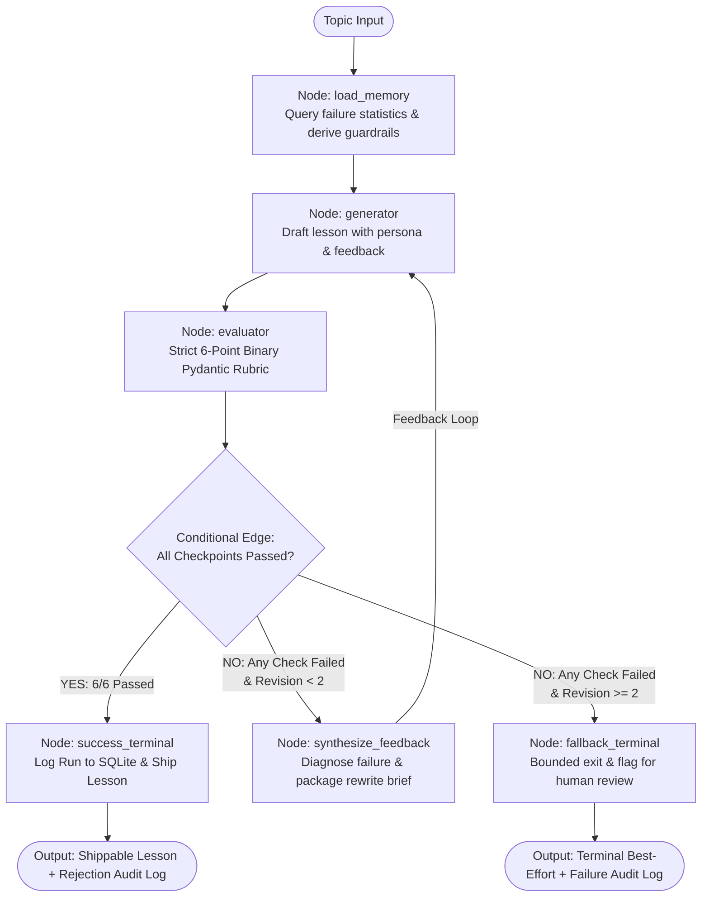

# Autonomous Self-Evaluating Lesson Content Generator
### GenAI Engineer - Content Systems | Take-Home Assessment

[](https://www.python.org/)
[](https://github.com/langchain-ai/langgraph)
[](https://pydantic.dev/)
[-blueviolet.svg)](https://aistudio.google.com/)

An autonomous, self-evaluating agentic system that generates high-quality beginner AI lessons tailored to specific student personas, evaluates drafts against an unyielding **binary pass/fail rubric**, and self-corrects through a bounded retry loop before any human ever sees the output.

---

## 📑 Table of Contents
1. [System Architecture](#-system-architecture)
2. [Target Persona & Pedagogical Grounding](#-target-persona--pedagogical-grounding)
3. [Strict Binary Evaluation Rubric](#-strict-binary-evaluation-rubric)
4. [Across the Pipeline: Memory & Self-Evolution](#-across-the-pipeline-memory--self-evolution)
5. [The Deliberate Error Demonstration Harness](#-the-deliberate-error-demonstration-harness)
6. [Design Choices & Trade-Offs](#-design-choices--trade-offs)
7. [Setup & Installation (Zero Cost)](#-setup--installation-zero-cost)
8. [Running the Application](#-running-the-application)
   - [Interactive Streamlit UI](#1-interactive-streamlit-ui-recommended-for-loom-video)
   - [CLI Execution](#2-command-line-interface-cli)
   - [Automated Test Suite](#3-running-automated-tests)
9. [Loom Video Demonstration Script (15–20 Mins)](#-loom-video-demonstration-script)

---

## 🏗️ System Architecture

The workflow is built as an explicit cyclic state machine using **LangGraph**:



### LangGraph State Schema (`AgentState`)
The agent's state transitions through typed fields:
* `topic`: Topic name (e.g., *"Introduction to RAG"*).
* `target_persona`: The learner profile and vocabulary constraints.
* `revision_count`: Integer counter ($0 \le \text{count} \le 2$).
* `current_draft`: The current Markdown text of the lesson.
* `evaluation`: Pydantic `LessonRubric` object with 6 strict boolean checks.
* `rejection_log`: Append-only list of historical attempts, failed checkpoints, and diagnostics.
* `sharpened_rules`: Dynamically injected guardrails derived from historical SQLite failure memory.
* `inject_deliberate_error`: Toggle for live demonstration of evaluator rejection on camera.
* `final_status`: Terminal outcome (`PASSED_SHIPPABLE` or `FAILED_MAX_RETRIES_EXCEEDED`).

---

## 🎯 Target Persona & Pedagogical Grounding

### The Learner
* **Profile:** 12th-grade graduate from India.
* **Background:** Non-English-medium / regional-language schooling.
* **Language Skill:** Limited English vocabulary, short sentence preference.
* **Goal:** Wants to kickstart a career in AI starting completely from zero.

### Pedagogical Strategy
1. **The Infallible Analogy:** Explains RAG through the **"Open-Book vs. Closed-Book Exam"**:
   - *Traditional LLM:* A student taking a test purely from memory. If they forgot or never learned the topic, they might panic and make up an answer (*hallucination*).
   - *RAG:* An open-book test. The student is handed the exact reference textbook (Retrieval), flips to the correct paragraph (Augmentation), and writes the answer based on real facts (Generation).
2. **Elimination of Ungrounded Jargon:** Advanced terms like *cosine similarity*, *loss functions*, or *vector embeddings* are strictly barred or simplified with physical metaphors (e.g., a library catalog or a smartphone contact list).
3. **Structured Triad:** The lesson strictly structures content into:
   - **Why It Matters (The Problem):** Why regular AI gets stuck without RAG.
   - **What It Is:** The intuition in plain words.
   - **How It Works (Step-by-Step):** Search $\to$ Attach $\to$ Answer.

---

## ✅ Strict Binary Evaluation Rubric

Partial credit (e.g., 7/10) produces noisy, un-actionable evaluations. This system enforces a **strict Boolean contract** (`True` or `False`) using Pydantic:

| Checkpoint | Target Dimension | Passing Criteria (True) | Failing Criteria (False) |
| :--- | :--- | :--- | :--- |
| `check_accuracy` | Accurate & Grounded | Factual accuracy on retrieval, prompt augmentation, and generation mechanisms. | Inaccuracies, confusing RAG with model fine-tuning, or inaccurate technical claims. |
| `check_persona_language` | Beginner-Friendly Language | Short, readable sentences (under 16-18 words); simple English suited for a non-English-medium student. | Dense academic prose, GRE-level vocabulary, or overly complex subordinate clauses. |
| `check_no_unexplained_jargon` | Zero Unexplained Jargon | Any AI buzzword (`hallucination`, `prompt`, `tokens`) is accompanied by an immediate real-life translation. | Technical buzzwords dumped naked without explanation; raw mathematical formulas. |
| `check_teaches_by_analogy` | Teaches by Example/Analogy | Uses the relatable "Open-Book Exam" or doctor's prescription file metaphor. | Abstract technical definitions only; no concrete real-life anchor. |
| `check_core_pillars` | Covers Key Points | Distinct sections explicitly answering: 1. What it is, 2. Why it matters, and 3. How it works. | Skips or glosses over any of the three pillars (especially why normal LLMs fail). |
| `check_coherent_flow` | Coherent Teaching Flow | Smooth step-by-step progression: Problem $\to$ Solution Intuition $\to$ Mechanism $\to$ Summary. | Jumbled sequence, jumping to mechanics before establishing the core problem. |

**Zero Partial Credit Rule:** If even 1 out of 6 checkpoints fails, the draft is rejected, logged in the audit trail, and redirected to the feedback-synthesis node.

---

## 🧠 Across the Pipeline: Memory & Self-Evolution

The assignment specifically requires:
> **SELF-EVOLVING:** learn from repeated failures to sharpen prompts/rubrics  
> **MEMORY:** persists across runs; learns from feedback + logs  

### 1. Persistent Storage (`memory/db.py`)
Every pipeline run, individual checkpoint outcome, and rejection critique is stored in a local SQLite database (`memory.db`):
- `pipeline_runs`: Tracks topic, persona, total revisions used, and final shippable status.
- `evaluation_audits`: Full JSON snapshots of each evaluation with timestamps and draft previews.
- `rejection_records`: Historical archive of what failed, why, and what corrective guidance was passed.

### 2. Self-Evolving Prompt Optimizer (`memory/optimizer.py`)
Before the generator writes a draft, `load_memory_node` queries SQLite to compute the historical frequency of checkpoint failures:

$$\text{Failure Frequency}(C) = \sum \text{Rejections where checkpoint } C \text{ failed}$$

If a checkpoint repeatedly fails across historical runs (e.g., `check_no_unexplained_jargon`), the system dynamically synthesizes targeted **Self-Evolved Guardrails** directly into the Generator's system prompt:

```text
SELF-EVOLVED GUARDRAIL [Jargon Defense]: Historical audit logs reveal frequent jargon failures. 
Strict prohibition: If you write words like 'vector', 'embedding', 'tokens', or 'hallucination', 
you MUST immediately follow with a plain daily-life translation in parentheses or a direct analogy.
```

This ensures the system continuously learns from past mistakes, reducing future retry cycles.

---

## 🧪 The Deliberate Error Demonstration Harness

To satisfy the submission requirement (*"your evaluator catching a deliberate error"*):
* A toggle switch (`--inject-error` in CLI or checkbox in the UI) activates demo mode.
* On **Attempt #0**, the generator deliberately injects an overly technical draft filled with mathematical formulas (`cosine similarity`, `latent Riemannian manifold`) and omits the *"Why it matters"* section.
* **Live System Response:**
  1. The Evaluator flags `check_persona_language = False`, `check_no_unexplained_jargon = False`, and `check_core_pillars = False`.
  2. The Rejection Logger creates an audit entry with exact diagnostic quotes.
  3. The Feedback Synthesizer translates the failures into explicit rewrite directives.
  4. The Generator produces **Attempt #1**, fixing the shortcomings.
  5. The Evaluator awards a clean **6/6 PASS**, and the lesson ships successfully.

---

## ⚖️ Design Choices & Trade-Offs

| Decision | Alternative Considered | Rationale & Trade-Off |
| :--- | :--- | :--- |
| **LangGraph Cyclic State Machine** | Linear pipeline or simple Python `while` loop | Provides deterministic state transitions, clear cycle visualization, and formal conditional branching. While slightly more boilerplate than a `while` loop, it guarantees production-grade maintainability. |
| **Strict Binary Rubric (Pydantic)** | 1–10 numeric scoring or Likert scale | Numeric scores create arbitrary thresholds (is 7.2 good enough to ship?) and vague feedback. Strict boolean flags provide unambiguous go/no-go decisions and clean diagnostic logging. |
| **Bounded Retry Ceiling (Max 2 Retries)** | Unbounded loop until pass | Prevents infinite loops and runaway API costs. If a model cannot clear the rubric in 2 retries, the system gracefully terminates and flags the content for human editorial review. |
| **Gemini 1.5 Flash (Free Tier)** | Paid OpenAI / Claude APIs | Zero API cost via Google AI Studio with high rate limits (15 RPM / 1M TPM). Provides rapid turnaround for real-time video demonstrations and native structured JSON adherence. |
| **SQLite File Persistence** | Vector DB / External Postgres | Zero external infrastructure dependencies. Allows complete portability and out-of-the-box local execution while fully satisfying multi-run persistence and memory analytics. |

---

## 🚀 Setup & Installation (Zero Cost)

### 1. Clone & Set Up Environment
```bash
git clone <your-repo-link>
cd nxtwave

# Create and activate a virtual environment (optional but recommended)
python -m venv venv
venv\Scripts\activate   # On Windows
# source venv/bin/activate  # On macOS/Linux

# Install dependencies
pip install -r requirements.txt
```

### 2. Configure Free Gemini API Key
1. Get a **100% free** API key from [Google AI Studio](https://aistudio.google.com/).
2. Create a `.env` file in the project root:
```bash
cp .env.example .env
```
3. Add your key inside `.env`:
```env
GEMINI_API_KEY=AIzaSy...your_actual_key_here
```

---

## 💻 Running the Application

### 1. Interactive Streamlit UI (Recommended for Loom Video)
Launch the interactive visual dashboard:
```bash
streamlit run app.py
```
Open `http://localhost:8501` in your browser. You will see:
* Pipeline status & memory inspector.
* Topic input with default *"Introduction to RAG"*.
* Deliberate error injection toggle.
* Tabs displaying the Shippable Lesson, the Rejection Audit Log, the Binary Rubric Checklist, and Architecture Diagrams.

### 2. Command-Line Interface (CLI)
Run a standard generation loop:
```bash
python main.py --topic "Introduction to RAG (Retrieval-Augmented Generation)"
```

Run with deliberate error injection to observe rejection and self-correction in terminal:
```bash
python main.py --inject-error
```

Output files will be automatically exported to `outputs/`:
* `outputs/final_lesson_RAG.md`: The shippable beginner lesson.
* `outputs/rejection_audit_log.json`: The complete audit trail of failures, critiques, and evaluations.

### 3. Running Automated Tests
Run the test suite verifying schemas, SQLite memory, and LangGraph routing:
```bash
python test_pipeline.py
python test_e2e_mock.py
```

---

## 📹 Loom Video Demonstration Script (15–20 Mins)

When recording your face-visible walkthrough for submission, follow this structured roadmap:

### 1. Executive Summary & Persona Context (2–3 mins)
* **Camera on face.** Introduce yourself and the mission: building an autonomous, self-evaluating content system, not just prompt engineering.
* Highlight the target persona: 12th-grade Indian graduate from a non-English-medium school. Explain why this audience demands strict vocabulary discipline and intuitive analogies.

### 2. Architecture & State Machine Walkthrough (4–5 mins)
* Open the **Streamlit UI** or code (`core/graph.py`).
* Explain the LangGraph state machine:
  - `load_memory` $\to$ `generator` $\to$ `evaluator` $\to$ `synthesize_feedback` $\to$ `generator`.
* Walk through the Pydantic schema in `core/state.py`: explain why strict boolean checks with zero partial credit were selected over fuzzy 1–10 scoring.
* Show the bounded retry ceiling (`MAX_REVISION_LIMIT = 2`) for operational safety.

### 3. Live Demo Part 1: Evaluator Catching a Deliberate Error (4–5 mins)
* Check the **"Inject Deliberate Error"** toggle in Streamlit and click **"Run Agentic Pipeline"**.
* Show Attempt #0 live on screen:
  - Highlight the dense math jargon (`cosine similarity`, `latent Riemannian manifold`) and missing *"Why it matters"* section.
  - Show the Evaluator rejecting the draft and displaying red fail badges on `check_persona_language`, `check_no_unexplained_jargon`, and `check_core_pillars`.
  - Show the **Rejection Audit Log** capturing the failure reasons and generating targeted rewrite guidance.
  - Watch the pipeline transition to Attempt #1, apply the feedback, and regenerate the lesson.
  - Show the Evaluator awarding green checkmarks across all 6 checkpoints.

### 4. Live Demo Part 2: Inspecting the Final Lesson Content (3–4 mins)
* Switch to the **Final Lesson Content** tab.
* Walk through the generated lesson:
  - Show how the *"Open-Book Exam vs. Closed-Book Exam"* analogy makes RAG immediately intuitive.
  - Verify that the three core pillars (What, Why, How) are clearly explained.
  - Point out that sentence lengths are short and words are accessible.

### 5. Memory, Self-Evolution & Design Trade-Offs (2–3 mins)
* Open the **Persistent Memory & Evolution** expander.
* Show how failure statistics in `memory.db` dynamically synthesize active guardrails to prevent future failures.
* Summarize key engineering trade-offs (deterministic booleans, bounded loops, local SQLite persistence).
* Conclude with confidence.
