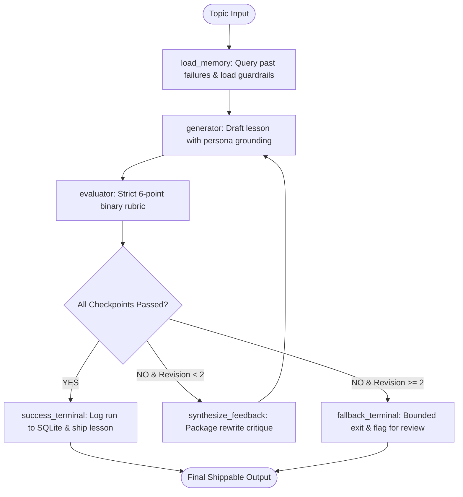

# Self-Evaluating Lesson Content Generator
An autonomous agentic system built with **LangGraph** that generates beginner AI lessons, evaluates them against a strict binary pass/fail rubric, and self-corrects using a bounded retry loop and persistent cross-run memory.

---

## 🚀 Quick Setup & Installation

### 1. Prerequisites
- Python 3.10+
- Free Google Gemini API Key from [Google AI Studio](https://aistudio.google.com/)

### 2. Clone & Install Dependencies
```bash
git clone <your-repo-url>
cd nxtwave

# Create virtual environment (optional)
python -m venv venv
venv\Scripts\activate       # On Windows
# source venv/bin/activate  # On macOS/Linux

# Install required packages
pip install -r requirements.txt
```

### 3. Configure API Key
Create a `.env` file in the project root:
```env
GEMINI_API_KEY=your_gemini_api_key_here
```

---

## 💻 How to Run

### 1. Interactive Web UI (Streamlit)
Launch the dashboard for live visual demonstration:
```bash
streamlit run app.py
```
Open `http://localhost:8501` to view:
- Live graph state execution (Drafting $\to$ Evaluating $\to$ Retrying).
- Deliberate error injection toggle (demonstrates evaluator rejection and self-correction).
- Final lesson markdown and detailed rejection audit logs.

### 2. CLI Execution
Run standard generation:
```bash
python main.py --topic "Introduction to RAG (Retrieval-Augmented Generation)"
```

Run with deliberate error injection to see live evaluator rejection in the terminal:
```bash
python main.py --inject-error
```

Output files will be saved to `outputs/`:
- `outputs/final_lesson_RAG.md` (shippable lesson)
- `outputs/rejection_audit_log.json` (audit trail)

---

## 🧪 Running Tests

Run the test suite:
```bash
# Unit tests: Pydantic rubric, SQLite memory & routing
python test_pipeline.py

# End-to-end integration test (simulates full generate -> reject -> retry cycle offline)
python test_e2e_mock.py
```

---

## 🏗️ Architecture & Workflow



---

## 📁 Project Structure

```text
nxtwave/
├── app.py                  # Streamlit web dashboard for live demo
├── main.py                 # CLI runner with telemetry and export flags
├── requirements.txt        # Frozen dependencies
├── .env.example            # Environment template
├── core/
│   ├── state.py            # TypedDict state and Pydantic binary rubric schema
│   ├── generator.py        # Lesson authoring node with persona constraints
│   ├── evaluator.py        # Strict binary evaluator (zero partial credit)
│   ├── feedback.py         # Rejection logger and feedback synthesizer
│   └── graph.py            # LangGraph state machine with max 2 retries
├── memory/
│   ├── db.py               # SQLite persistence for runs and rejection logs
│   └── optimizer.py        # Analyzes historical failures to sharpen prompts
├── outputs/
│   ├── final_lesson_RAG.md # Benchmark generated lesson
│   └── rejection_audit_log.json
├── test_pipeline.py        # Unit tests
└── test_e2e_mock.py        # End-to-end simulation test
```

---

## 🎯 Key Design Choices

1. **Strict Binary Rubric (No Partial Credit):** Evaluates drafts across 6 Boolean checkpoints (`True`/`False`). Eliminates ambiguous numeric scores.
2. **Bounded Retry Loop:** Capped at a hard limit of **2 retries** to prevent infinite loops and runaway token usage.
3. **Cross-Run Memory & Self-Evolution:** SQLite logs failure modes across runs and dynamically injects prevention guardrails into subsequent prompts.
